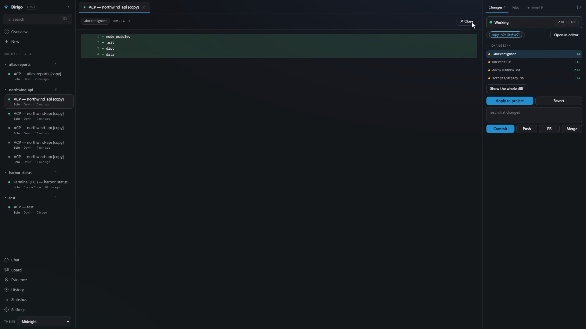
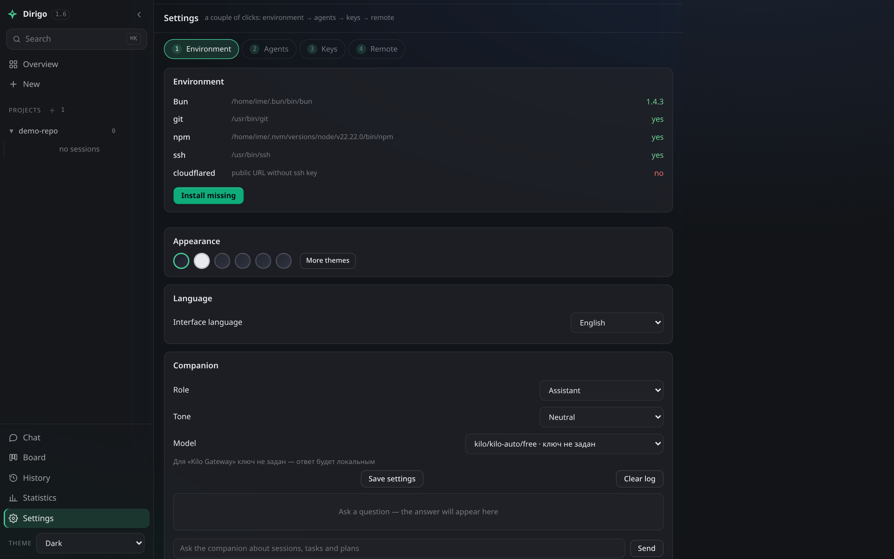
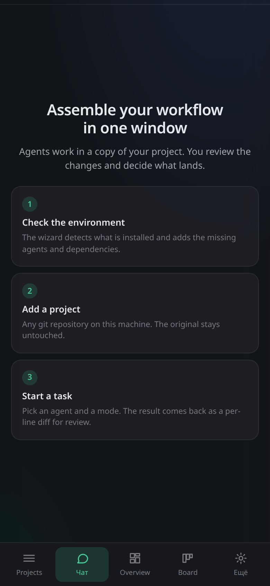

<div align="center">

# Dirigo

**A self-hosted control panel for AI coding agents.**
One daemon on your machine. Agents work in isolated copies of your project.
Nothing reaches your real code until you approve it, line by line.

[Quick start](#quick-start) · [How it works](#how-it-works) · [Evidence](#evidence) · [Personal data](#personal-data-gate) · [Agents](#supported-agents) · [Security](#security-model) · [Русский](README.ru.md)

</div>

---



## Why

One coding agent in a terminal does one task at a time. Start a second one in the
same repository and they overwrite each other's files and break the build. The
usual answers are: run a single agent and wait, run several in one working tree
and clean up the mess, or upload your code to a cloud platform and pay a
middleman.

Dirigo takes a different route. Every agent gets its own git worktree. Automatic
checks (tests, lint, build) run **before** a human ever sees the result — if they
fail, the work goes back to the agent, not to you. What reaches you is a per-line
diff you can comment on and then apply or discard. All of it runs on your own
machine, on top of the agent subscriptions you already pay for.

There is a second half to the problem, and it shows up later. Once the work is
applied, the agent session is gone: nobody can say which model wrote a change,
what verified it, who approved it, or whether a customer's e-mail went into the
context window. That record cannot be reconstructed from a merged branch — it
only exists while the agent is working. So Dirigo writes it down at that moment:
**every applied change leaves a signed evidence pack, and everything going to or
coming from the agent passes a personal-data gate.**

## Quick start

```bash
curl -fsSL https://dirigo.cortexally.ai/install.sh | bash
```

The installer checks your platform, installs Bun if missing, downloads the
release bundle, verifies its SHA256, unpacks into `~/.dirigo` and starts the
daemon on <http://127.0.0.1:7171>.

From source:

```bash
git clone https://github.com/cortexally/dirigo.git
cd dirigo
bun run src/server.ts        # → http://127.0.0.1:7171
```

Requirements: [Bun](https://bun.sh) 1.2+. Linux, macOS and Windows.
No npm dependency tree — the only optional native module is `node-pty`, and the
daemon runs fine without it (the terminal falls back to pipes).

## How it works

```
Browser / PWA / CLI / MCP client
            │  REST + Server-Sent Events
            ▼
      Dirigo daemon  (Bun, single process)
            │
            ├── git worktree per session      ← agent never touches your main tree
            ├── agent process (CLI or ACP)    ← your installed agent, your keys
            ├── automatic checks              ← tests/lint/build before review
            ├── personal-data gate            ← on the task, the messages, the code
            ├── per-line diff + apply/revert  ← you decide what lands
            └── signed evidence + ledger      ← what happened, provably
```

- **Isolation.** Each session is a `git worktree` with a return point. Limits and
  TTL keep copies from piling up.
- **Review first.** Checks run automatically; broken work is sent back to the
  agent (up to 2 iterations) before it ever appears in your queue.
- **Four modes.** `Solo` (one agent, one task) · `Swarm` (parallel areas) ·
  `Fusion` (several solutions, a judge picks) · `Orchestrator` (epic → plan →
  acceptance → conflict resolution).
- **Evidence.** Every applied change produces a signed pack over an append-only,
  hash-chained ledger. See [Evidence](#evidence).
- **Personal-data gate.** The task, every message to the agent and every line the
  agent writes are scanned. See [Personal-data gate](#personal-data-gate).
- **Setup wizard.** Detects what is already installed, installs the missing
  agents and dependencies, collects keys, verifies each agent afterwards.



## Supported agents

Dirigo drives the agent CLIs you already have. It never stores their API keys —
each agent keeps using its own configuration.

| | |
|---|---|
| OpenCode | Kilo |
| Cursor Agent | Devin |
| Hermes | ZCode |
| MiniMax (mcode) | Claude Code |
| Codex | GitHub Copilot |
| Gemini | Cline |
| FreeBuff | |

Adding another one is a single entry in `src/agents/registry.ts`.

## Evidence

A chat transcript is not evidence: it can be edited, trimmed, or lost with the
account it lived in. So every change you apply writes a record instead.

Each applied change produces a **pack** holding the agent, the model and
reasoning level, the run mode, every check that ran with its result, how many
times the work was returned to the agent, who approved it, the files, the commit
hash, and the personal-data findings.

Underneath, each session keeps an **append-only ledger** where every entry
carries the hash of the one before it. The pack is signed with the instance's
Ed25519 key and carries the ledger head. One action verifies every signature and
the whole chain; edit a line of the ledger in place and verification reports a
broken chain instead of passing.

The signing key is generated on your instance and stays there — it is your
evidence, not ours. An auditor does not get a login either: evidence for a period
exports as a file.

The record also survives outside the product. Commits made from the panel carry
git trailers you can read with no tooling at all:

```console
$ git log -1 --format=full
commit ccd4aa8149fe58245948ebdff2b4867b31c5a8cf
    feat: shipment stats endpoint

    Dirigo-Agent: devin
    Dirigo-Ledger-Head: 27aa3f07fccb1ca3
```

Also available: `Dirigo-Model`, `Dirigo-Checks`, `Dirigo-Returned-To-Agent`.
No plugin, no database — anyone who can clone the repository can read them years
from now.

## Personal-data gate

An agent will put a customer name into a log line, or a key into a comment. It is
not malicious — it is working with what it was given.

The gate sits in front of that, in three places: the **task text**, **every
message** you send the agent, and **every line the agent writes into a file** —
enforced both when you apply and when you commit.

It looks for e-mail addresses, phone numbers, IBANs, card numbers (Luhn-checked),
keys and tokens, JWTs, public IP addresses, full names, and the terms that only
mean something inside your company — client names, contract numbers — which you
list yourself.

Four modes: `off`, `warn`, `redact`, `block`. The default is `warn`. In `block`
mode an approver can override consciously, and the override itself is written
into the evidence pack, which says the change was applied against policy and who
said so.

**Findings are stored as kind, offset and length. The value itself is never
written down** — not in the ledger, not in the evidence.

This is a technical control, not a certification: the gate detects and records,
and tuning the policy to a given organisation is part of deploying it.

## Company knowledge base

Approved work can be written into [CoAlly Nexus](https://coally.cortexally.ai),
an MCP server that holds a company's decisions and task context, after it has
passed the personal-data gate. One action writes the MCP server into the config
of every agent installed on the machine, with backups and merge-safe writes, so
each agent can search that knowledge through its own MCP tools.

## Remote access

Your phone, your laptop, another network — without opening ports:

- **Cloudflare quick tunnel** — two clicks in the UI, public HTTPS URL.
- **Tailscale** — bind to `0.0.0.0`, reach the panel from your tailnet.
- **SSH deploy** — install the daemon on your own server; it listens on
  `127.0.0.1` there and is reached through an SSH tunnel.

The web UI is a PWA: install it on a phone and queue tasks from anywhere.



## Security model

Read this before exposing anything.

- The daemon runs agents **with the privileges of the user who started it**.
  Anyone who can reach the panel can run arbitrary commands on that machine.
- Default bind is `127.0.0.1` — local only.
- For any external access set `DIRIGO_TOKEN` (32+ characters) **and** use a
  tunnel. The UI shows a login screen; SSE authenticates through a
  `SameSite=Strict` cookie.
- Security headers on all static assets (CSP with a per-file script hash,
  `X-Content-Type-Options: nosniff`).
- Install scripts verify SHA256 of the bundle and refuse plain HTTP.
- Agent API keys stay in the agents' own config directories.

Found a vulnerability? See [SECURITY.md](SECURITY.md).

## Configuration

| Variable | Default | Meaning |
|---|---|---|
| `PORT` / `DIRIGO_PORT` | `7171` | HTTP port |
| `HOST` | `127.0.0.1` | bind address |
| `DIRIGO_TOKEN` | — | required for any non-loopback access |
| `DIRIGO_DATA` | `./data` | data directory (isolated instances, tests) |
| `DIRIGO_MAX_WORKTREES` | `8` | parallel project copies |
| `DIRIGO_WORKTREE_TTL_HOURS` | `24` | when stale copies are cleaned |
| `DIRIGO_MAX_PROCESSES` | `12` | concurrent agent processes |
| `DIRIGO_AUTO_CHECKS` | `1` | run checks automatically after an agent finishes |

Full list in [`.env.example`](.env.example).

## Interfaces beyond the web UI

- **CLI** — `./orch` (`bun run scripts/orch.ts`): sessions, copies, diffs, apply.
- **MCP server** — `scripts/mcp.ts` exposes the panel as tools to any MCP client.
- **TypeScript SDK** — `sdk/dirigo.ts`, typed client over the REST API.
- **Docker** — `docker-compose up`, mounts your projects directory.

## Running and stopping it

```bash
bun run src/server.ts                 # the panel on http://127.0.0.1:7171
./start.sh                            # same, plus it opens your browser
```

Use an isolated data directory for anything experimental, so test sessions and
project copies never land in your real instance:

```bash
DIRIGO_DATA=/tmp/dirigo-sandbox PORT=7399 bun run src/server.ts
```

To stop it: `Ctrl+C` if it runs in the foreground, otherwise kill it by port —
`fuser -k 7399/tcp` (Linux) or `lsof -ti :7399 | xargs kill` (macOS).
`ss -ltnp | grep 7399` shows what is listening. Do not use
`pkill -f src/server.ts`: the pattern matches your own shell command.

Health check:

```bash
curl -s http://127.0.0.1:7171/api/health
```

`platform` tells you the OS, arch and Bun version; `capabilities.pty` is
`false` when the optional native module is absent — the daemon still works and
the terminal falls back to pipes.

If the panel shows a red "no connection to the daemon" bar, the daemon is not
listening. The page itself can still look alive because the service worker
serves the cached shell. Start the daemon and press Retry.

## Tests

```bash
bun run smoke          # API contracts, copies, review, degradation
bun run e2e            # browser regression of the panel (playwright, 65 checks)
bun run scripts/pre-release.ts   # the full gate, 20+ suites
```

Honest numbers, measured on a clean Linux machine **with no agent CLIs
installed**: `bun run smoke` passes **169/179** and <!-- check-materials:ignore -->
**17 of the 23 suites that can run without an agent are fully green**
(including `ui-audit` at 61/61). Every remaining failure needs a
real agent binary — web panels, persistent ACP sessions, and the flows that
require an agent to actually produce a diff. Install one agent and they go green.
Under heavy parallel load smoke occasionally reports 168 instead of 169; CI
therefore gates at 165.

## Project layout

```
src/        daemon: HTTP routes, store, worktrees, checks, modes, deploy
web/        the panel itself (vanilla JS, no build step)
scripts/    test suites, CLI, MCP server, release tooling
sdk/        TypeScript client
skills/     reusable agent instructions
site/       the product website (static, zero external requests)
```

## Contributing

Issues and pull requests are welcome — see [CONTRIBUTING.md](CONTRIBUTING.md).
The codebase has no build step and no npm dependency tree, so the loop is short:
edit, reload, run a suite.

## License

MIT — see [LICENSE](LICENSE).
