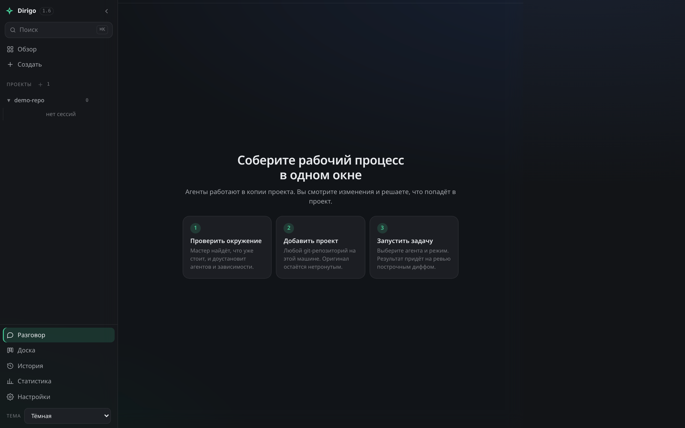
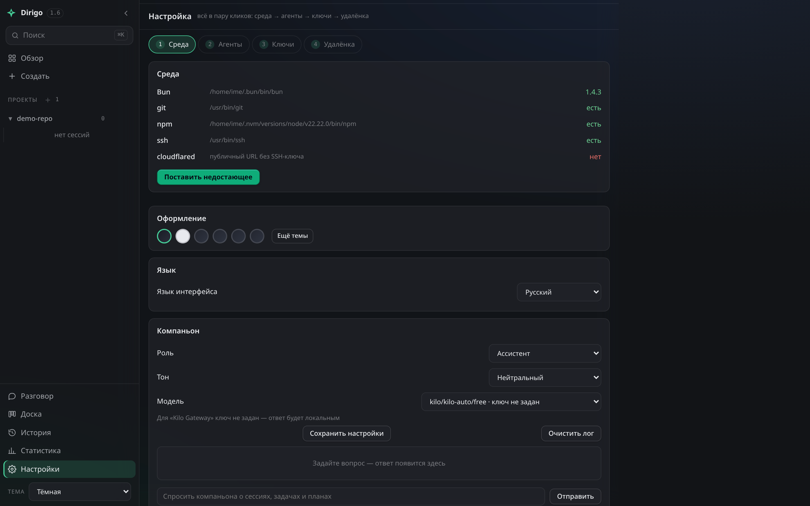
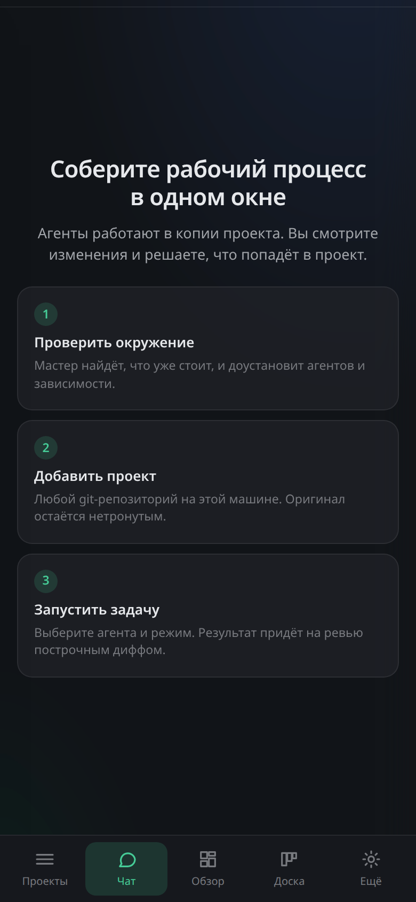

<div align="center">

# Dirigo

**Self-hosted пульт для ИИ-агентов разработки.**
Один демон на вашей машине. Агенты работают в изолированных копиях проекта.
В настоящий код ничего не попадает, пока вы не одобрите это построчно.

[Быстрый старт](#быстрый-старт) · [Как устроено](#как-устроено) · [Доказательства](#доказательства) · [Персональные данные](#шлюз-персональных-данных) · [Агенты](#поддерживаемые-агенты) · [Безопасность](#модель-безопасности) · [English](README.md)

</div>

---



## Зачем

Один агент в терминале делает одну задачу. Запустить второго в том же
репозитории нельзя: они пишут в одни файлы, затирают друг друга и ломают сборку.
Обычные выходы — работать одним агентом и ждать, гонять несколько в одном
рабочем дереве и потом разгребать, или залить код в облачную платформу и платить
посреднику.

Dirigo идёт другим путём. Каждый агент получает свою git-копию проекта.
Автоматические проверки (тесты, линт, сборка) гоняются **до** того, как результат
увидит человек: если они красные, работа уходит обратно агенту, а не вам. До вас
доходит построчный дифф — с замечаниями, «применить» или «откатить». Всё это на
вашей машине и поверх подписок на агентов, за которые вы уже платите.

## Быстрый старт

```bash
curl -fsSL https://dirigo.cortexally.ai/install.sh | bash
```

Установщик проверит платформу, поставит Bun при необходимости, скачает бандл,
сверит SHA256, распакует в `~/.dirigo` и запустит демон на
<http://127.0.0.1:7171>.

Из исходников:

```bash
git clone https://github.com/cortexally/dirigo.git
cd dirigo
bun run src/server.ts        # → http://127.0.0.1:7171
```

Требуется [Bun](https://bun.sh) 1.2+. Linux, macOS, Windows.
Дерева npm-зависимостей нет; единственный опциональный нативный модуль —
`node-pty`, и демон полноценно работает без него (терминал переходит на пайпы).

## Как устроено

```
Браузер / PWA / CLI / MCP-клиент
            │  REST + Server-Sent Events
            ▼
      Демон Dirigo  (Bun, один процесс)
            │
            ├── git worktree на сессию        ← агент не трогает ваше дерево
            ├── процесс агента (CLI или ACP)  ← ваш агент, ваши ключи
            ├── автоматические проверки       ← тесты/линт/сборка до ревью
            ├── шлюз персональных данных      ← задача, сообщения, код агента
            ├── построчный дифф + применить   ← вы решаете, что попадёт в проект
            └── подписанные доказательства    ← что произошло, с возможностью проверить
```

- **Изоляция.** Каждая сессия — `git worktree` с точкой возврата. Лимит копий и
  TTL не дают им накапливаться.
- **Ревью-первый.** Проверки гоняются автоматически; сломанное возвращается
  агенту (до 2 итераций) и не попадает к вам в очередь.
- **Четыре режима.** `Solo` (один агент, одна задача) · `Swarm` (параллельные
  участки) · `Fusion` (несколько решений, судья выбирает) · `Orchestrator`
  (эпик → план → приёмка → разрешение конфликтов).
- **Мастер настройки.** Находит, что уже стоит, доустанавливает недостающих
  агентов и зависимости, собирает ключи и проверяет каждого после установки.



## Поддерживаемые агенты

Dirigo управляет теми CLI-агентами, что у вас уже есть, и не хранит их
API-ключи — каждый агент продолжает жить в своём конфиге.

| | |
|---|---|
| OpenCode | Kilo |
| Cursor Agent | Devin |
| Hermes | ZCode |
| MiniMax (mcode) | Claude Code |
| Codex | GitHub Copilot |
| Gemini | Cline |
| FreeBuff | |

Добавить ещё одного — одна запись в `src/agents/registry.ts`.

## Доказательства

Переписка с агентом — не доказательство: её можно отредактировать, обрезать или
потерять вместе с аккаунтом. Поэтому каждое применённое изменение оставляет
запись.

В **пакете** фиксируются: агент, модель и уровень рассуждения, режим запуска,
каждая прошедшая проверка с результатом, сколько раз работа возвращалась агенту,
кто одобрил, какие файлы изменились, хеш коммита и находки шлюза персональных
данных.

Под ним у каждой сессии лежит **журнал, в который можно только дописывать**: в
каждой записи — хеш предыдущей. Пакет подписывается ключом Ed25519 этого
экземпляра и несёт в себе голову журнала. Одно действие проверяет все подписи и
всю цепочку сразу: если отредактировать строку журнала на месте, проверка
сообщит о нарушении целостности вместо того, чтобы пройти.

Ключ подписи создаётся на вашем экземпляре и остаётся там — это ваши
доказательства, не наши. Аудитору не нужен доступ в систему: выгрузка за период
отдаётся файлом.

Запись живёт и за пределами продукта. Коммиты из пульта несут git-трейлеры,
которые читаются вообще без инструментов:

```console
$ git log -1 --format=full
commit ccd4aa8149fe58245948ebdff2b4867b31c5a8cf
    feat: shipment stats endpoint

    Dirigo-Agent: devin
    Dirigo-Ledger-Head: 27aa3f07fccb1ca3
```

Есть ещё `Dirigo-Model`, `Dirigo-Checks`, `Dirigo-Returned-To-Agent`. Ни плагина,
ни базы данных — любой, кто может склонировать репозиторий, прочитает это и через
несколько лет.

## Шлюз персональных данных

Агент впишет имя клиента в строку лога или ключ — в комментарий. Это не злой
умысел: он работает с тем, что ему дали.

Шлюз стоит перед этим в трёх местах: **текст задачи**, **каждое сообщение**
агенту и **каждая строка, которую агент пишет в файл** — и срабатывает как при
«Применить», так и при коммите.

Он ищет адреса почты, телефоны, IBAN, номера карт (с проверкой Луна), ключи и
токены, JWT, публичные IP-адреса, ФИО — и те слова, которые что-то значат только
внутри вашей компании: имена клиентов, номера договоров. Их вы перечисляете сами.

Четыре режима: `off`, `warn`, `redact`, `block`. По умолчанию — `warn`. В режиме
`block` одобряющий может осознанно сделать исключение, и само исключение
записывается в пакет доказательств: там будет сказано, что изменение применили
вопреки политике, и кто это решил.

**Находки хранятся как тип, смещение и длина. Само значение не записывается
нигде** — ни в журнал, ни в доказательства.

Это техническое средство контроля, а не сертификация: шлюз обнаруживает и
записывает, а настройка политики под конкретную организацию — часть внедрения.

## База знаний компании

Одобренная работа может записываться в [CoAlly Nexus](https://coally.cortexally.ai) —
MCP-сервер, который хранит решения и контекст задач компании, после прохождения
шлюза персональных данных. Одно действие прописывает MCP-сервер в конфиги всех
установленных на машине агентов (с резервными копиями и аккуратной дозаписью),
и каждый агент может искать в этой базе своими MCP-инструментами.

## Удалённый доступ

Телефон, ноутбук, другая сеть — без проброса портов:

- **Cloudflare quick tunnel** — два клика в интерфейсе, публичный HTTPS-адрес.
- **Tailscale** — слушать `0.0.0.0` и открывать пульт из своего tailnet.
- **Деплой по SSH** — поставить демон на свой сервер; там он слушает
  `127.0.0.1`, доступ — через SSH-туннель.

Веб-интерфейс — PWA: ставится на телефон, задачи ставятся откуда угодно.



## Модель безопасности

Прочитайте это до того, как открывать доступ наружу.

- Демон запускает агентов **с правами пользователя, который его запустил**.
  Любой, кто дотянется до пульта, выполнит произвольные команды на этой машине.
- По умолчанию слушает `127.0.0.1` — только локально.
- Для любого внешнего доступа задайте `DIRIGO_TOKEN` (32+ символа) **и**
  используйте туннель. UI покажет экран входа; SSE авторизуется cookie с
  `SameSite=Strict`.
- Заголовки безопасности на всей статике (CSP с хешом инлайн-скрипта,
  `X-Content-Type-Options: nosniff`).
- Установочные скрипты сверяют SHA256 бандла и отказываются работать по HTTP.
- Ключи агентов остаются в конфигах самих агентов.

Нашли уязвимость — [SECURITY.md](SECURITY.md).

## Настройки

| Переменная | По умолчанию | Смысл |
|---|---|---|
| `PORT` / `DIRIGO_PORT` | `7171` | порт HTTP |
| `HOST` | `127.0.0.1` | адрес привязки |
| `DIRIGO_TOKEN` | — | обязателен для любого доступа не с loopback |
| `DIRIGO_DATA` | `./data` | каталог данных (изолированные инстансы, тесты) |
| `DIRIGO_MAX_WORKTREES` | `8` | параллельных копий проекта |
| `DIRIGO_WORKTREE_TTL_HOURS` | `24` | когда чистить залежавшиеся копии |
| `DIRIGO_MAX_PROCESSES` | `12` | одновременных процессов агентов |
| `DIRIGO_AUTO_CHECKS` | `1` | гонять проверки сразу после работы агента |

Полный список — в [`.env.example`](.env.example).

## Интерфейсы помимо веба

- **CLI** — `./orch` (`bun run scripts/orch.ts`): сессии, копии, диффы, применение.
- **MCP-сервер** — `scripts/mcp.ts` отдаёт пульт как набор инструментов любому
  MCP-клиенту.
- **TypeScript SDK** — `sdk/dirigo.ts`, типизированный клиент к REST API.
- **Docker** — `docker-compose up`, каталог проектов монтируется внутрь.

## Запуск и остановка

```bash
bun run src/server.ts                 # пульт на http://127.0.0.1:7171
./start.sh                            # то же самое, плюс откроет браузер
```

Для любых экспериментов задавайте изолированный каталог данных, иначе тестовые
сессии и копии проектов попадут в ваш боевой инстанс:

```bash
DIRIGO_DATA=/tmp/dirigo-sandbox PORT=7399 bun run src/server.ts
```

Остановка: `Ctrl+C`, если демон на переднем плане, иначе по порту —
`fuser -k 7399/tcp` (Linux) или `lsof -ti :7399 | xargs kill` (macOS).
Что слушает порт, покажет `ss -ltnp | grep 7399`. Не используйте
`pkill -f src/server.ts`: шаблон совпадает с вашей же командой в оболочке.

Проверка состояния:

```bash
curl -s http://127.0.0.1:7171/api/health
```

`platform` — ОС, архитектура и версия Bun; `capabilities.pty` равен `false`,
если опциональный нативный модуль не собран: демон при этом работает, а
терминал переходит на пайпы.

Если в пульте висит красная полоса «нет связи с демоном» — демон не слушает
порт. Сама страница может выглядеть живой: её отдаёт service worker из кэша.
Запустите демон и нажмите «Повторить».

## Тесты

```bash
bun run smoke          # контракты API, копии, ревью, деградация
bun run e2e            # браузерная регрессия пульта (playwright, 65 проверок)
bun run scripts/pre-release.ts   # полный гейт, 20+ сьютов
```

Честные цифры, измеренные на чистой Linux-машине **без единого
установленного агента**: `bun run smoke` даёт **169/179**, полностью зелёных
**17 сьютов из 23** (в том числе `ui-audit` — 61/61). Все оставшиеся падения
требуют реального бинарника агента: веб-панели, persistent-сессии ACP и флоу,
где агент должен действительно сделать дифф. С одним установленным агентом они
зеленеют. Под сильной параллельной нагрузкой smoke иногда отдаёт 168 вместо
169 — поэтому порог в CI выставлен в 165.

## Структура

```
src/        демон: HTTP-роуты, хранилище, копии, проверки, режимы, деплой
web/        сам пульт (vanilla JS, без сборки)
scripts/    тест-сьюты, CLI, MCP-сервер, релизные инструменты
sdk/        TypeScript-клиент
skills/     переиспользуемые инструкции для агентов
site/       сайт продукта (статика, ноль внешних запросов)
```

## Участие

Issues и pull requests приветствуются — [CONTRIBUTING.md](CONTRIBUTING.md).
Ни сборки, ни дерева npm-зависимостей: правите файл, перезагружаете страницу,
гоняете сьют.

## Лицензия

MIT — [LICENSE](LICENSE).
